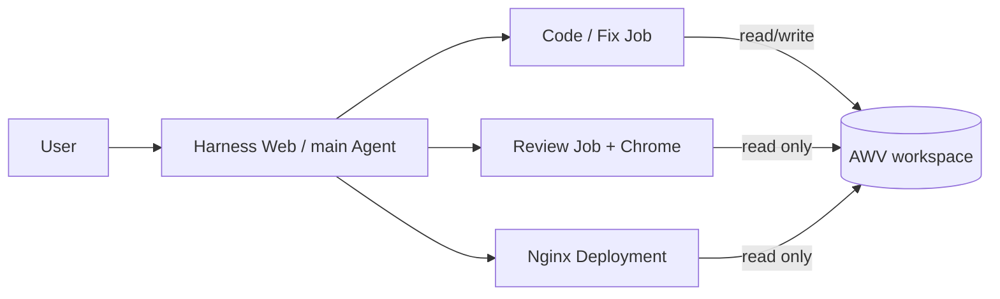

# How the example works

DeepSeek Harness plans the task. The Kubernetes Provider starts short-lived Code and Review Jobs and publishes the reviewed page through an Nginx Deployment. Fix uses another Code Job. There is no external script orchestrating the application workflow.

## Agent and workspace contract

- The main Agent creates tasks from the user's request. Profiles define tools and output formats, not a fixed implementation or review answer.
- Code writes `/workspace/site/index.html` and runs browser self-checks. Review is a separate process and performs browser checks with a read-only workspace.
- After a failed Review, the main Agent may invoke Code once to fix all blocking issues, then Review again. Agent errors or a second failed Review stop publication.
- Workers start `tini -- dsh` directly. They do not run a shell, download dependencies at startup, or receive Kubernetes credentials.
- A Lease serializes workspace access. Before Code or Review, the Provider scales the display Deployment to zero. Kubernetes and AWV handle unmounting and remounting; do not force-detach a volume.
- Every successful Code task increments `generation` and marks Review dirty. Publication requires `reviewStatus=PASS`, `generation>0`, and `reviewedGeneration=generation`.
- Files persist in AWV. Job task text is passed in temporary ConfigMaps; review results are stored in a state ConfigMap. Controller sessions, process memory and browser state are not stored in AWV.

## Permissions and data

The Controller has Namespace-scoped access to Jobs, Pod logs, ConfigMaps, Leases, Deployments and Services. Workers and the display Pod do not mount ServiceAccount tokens. Review and Nginx mount the workspace read-only; Code and Nginx share UID/GID `10001:10001` so Nginx can read Code-created files. Review screenshots live in the Pod's temporary directory and are not durable evidence files.

Model credentials are read from a Secret by the Controller and Workers. Nginx receives no model credentials. Use a separate Namespace, PVC, Secret and Harness instance for each isolated project. Concurrent writers to one workspace are not supported.

## Versions and current limits

The example pins Harness `0.1.5-rc.2` and Playwright MCP `0.0.80`. Chrome is installed during the amd64 Worker image build. The Provider's TypeScript is tested directly through `tsx`; compiled JavaScript is generated only when packaging the plugin in the Controller image.

`images/harness/` locks the Harness runtime and its matching DSH component versions. Its hoisted dependency layout keeps native modules shared; pinning only the CLI can otherwise pull a newer release train and create duplicate native type registrations. Keep these manifests and their lockfile together when updating Harness.

Controller profiles load patches at startup. They run as immutable container configuration and do not require the development HMR/file-watching service; rebuild or restart the Controller when changing its packaged patches.

With this Harness version, browser tools navigate, render, take screenshots, inspect DOM/computed styles, check animations and interactions, and read console errors. Screenshot results appear as file links in the model context, not inline image blocks. Do not describe the demo as model-based visual image recognition. An image-capable endpoint alone does not fix that transport limitation.

Harness Web defaults to ClusterIP and local port forwarding. The published page uses a LoadBalancer Service and requires a cluster that can provision it. HTTP exposure is suitable only for a controlled demo. Remote Web access also requires explicit `controller.trustedHosts`; token-bearing login URLs must remain private. Changing the Controller configuration can discard its in-memory/local conversation sessions.

AWV preserves files across sequential Pod mounts and recreation. It does not resume Agent processes, preserve model context, or speed up model inference. End-to-end times include model calls, browser operations, scheduling, image pulls and volume mounts, so they are not an AWV performance benchmark.
